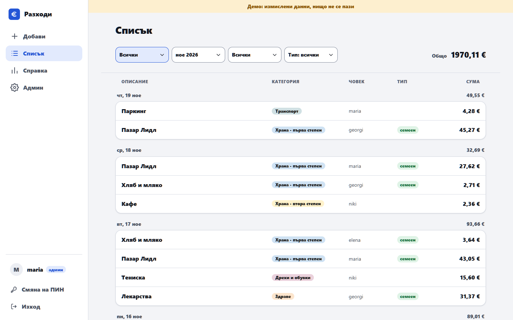

<div align="center">


# Разходи · Demo

### [▶&nbsp; Open the demo](https://petarivanov03.github.io/spendings-list/demo/)

Made-up data &nbsp;·&nbsp; nothing is saved &nbsp;·&nbsp; no account needed

[Back to the README](README.md)

</div>

<br />

<p align="center">
  <picture>
    <source media="(prefers-color-scheme: dark)" srcset="docs/screenshots/desktop-dark.png" />
    
  </picture>
</p>

## 👋 Log in as anyone

On the login screen, tap one of the people. You can also type a name with **any 6-digit PIN**.

| Role | Name | What they can do |
| :-- | :-- | :-- |
| **Admin** | `maria` | Everything: every expense, the family report, categories and the trash |
| **Parent** | `georgi`, `elena` | Sees the whole family's expenses and reports, edits only their own |
| **Member** | `niki` | Sees and edits only their own expenses |

> [!NOTE]
> The app is in Bulgarian, like the real one. „Добави“ is *Add*, „Списък“ is *List*, „Справка“ is *Summary*.

## 🧭 Things to try

- **Add an expense** in a few taps. Mark it „Мой“ (*mine*) or „Семеен“ (*family*), or start from a template chip.
- **List**: filter by person, month, category or type. Tap a row to edit or delete it.
- **Summary**: the month's total, by category, by person, and personal vs. family.
- **Admin** (`maria`): rename, hide and reorder categories. Restore something you deleted from „Кошче“ (*trash*).
- **Resize the window**: below 960 px it is the phone app, above it the desktop layout.

## 🔍 Demo vs. the real app

| | Real app | Demo |
| :-- | :-- | :-- |
| Screens and features | ✅ | ✅ the same code |
| Data | Supabase (Postgres) | Made up, kept in the open page only |
| After a reload | Your data is there | Starts over |
| Login | Name + personal PIN | Any demo name + any PIN |
| Network requests | Supabase only | None |
| Installable (PWA) | ✅ | ❌ |

## 🛠️ How it works

The demo is a second build of the same source, published next to the app at `/spendings-list/demo/`.

```bash
cd frontend
npm run dev:demo      # local
npm run build:demo    # -> dist/demo (the deploy workflow runs it)
```

- **One swap.** `vite --mode demo` replaces `src/supabase.ts` with [`src/demo/backend.ts`](frontend/src/demo/backend.ts). It answers the same requests from memory, with the same role rules as the database. No screen knows the difference.
- **No database code.** The demo bundle does not include the Supabase client.
- **Kept apart from the real app.** Both are served from the same domain, so the demo stores its data under its own prefix (`spend-demo:`). It registers no service worker and has no install manifest, and the real app's service worker ignores `/demo/`.
- **Made-up data only.** The people and the data are generated in [`src/demo/`](frontend/src/demo/). Nothing real ever goes in there, because the repo is public.
