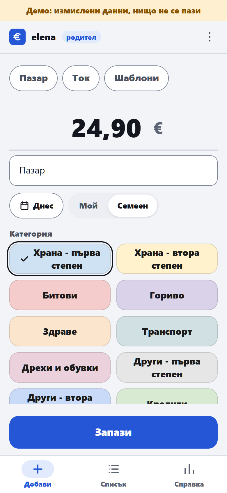
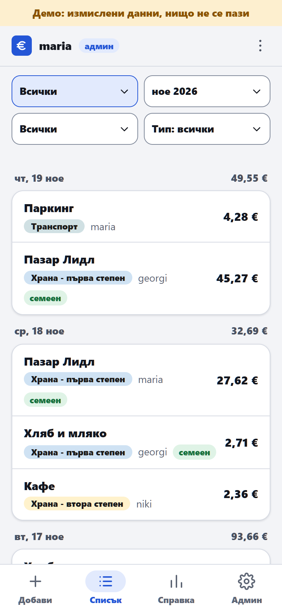
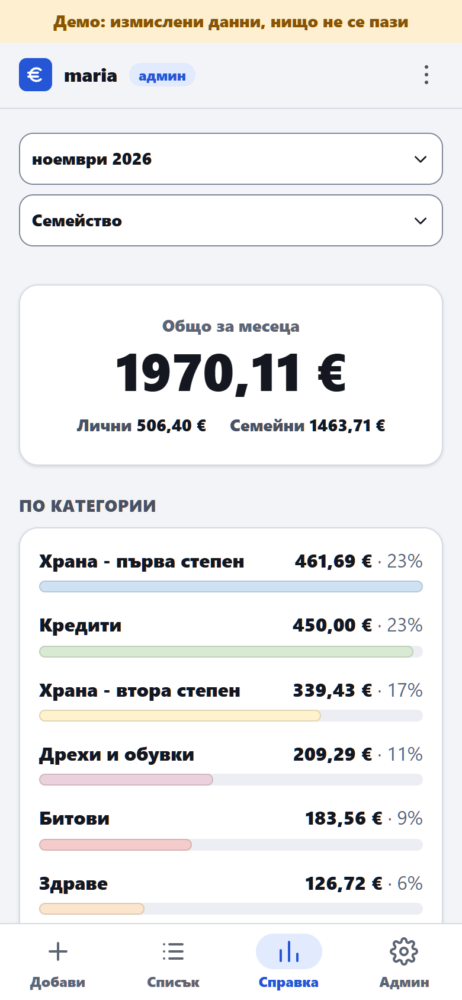
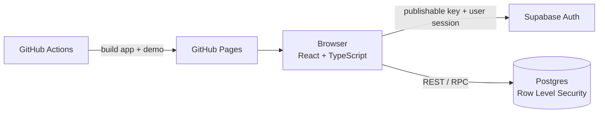

<div align="center">


# Разходи · spendings-list

**A phone-first expense tracker for a family of four.**<br />
Add an expense in three taps, see where the month went at a glance.

[](https://petarivanov03.github.io/spendings-list/demo/)
&nbsp;
[](https://github.com/PetarIvanov03/spendings-list/actions/workflows/deploy.yml)

React &nbsp;·&nbsp; TypeScript &nbsp;·&nbsp; Vite &nbsp;·&nbsp; Supabase &nbsp;·&nbsp; GitHub Pages

</div>

<br />

<p align="center">
  <picture>
    <source media="(prefers-color-scheme: dark)" srcset="docs/screenshots/add-dark.png" />
    
  </picture>
  &nbsp;
  <picture>
    <source media="(prefers-color-scheme: dark)" srcset="docs/screenshots/list-dark.png" />
    
  </picture>
  &nbsp;
  <picture>
    <source media="(prefers-color-scheme: dark)" srcset="docs/screenshots/summary-dark.png" />
    
  </picture>
</p>

<p align="center"><sub>Screenshots from the <a href="DEMO.md">demo</a>: made-up people and amounts.</sub></p>

## ✨ Highlights

**Everyday use**
- ⚡ **Fast entry:** amount, what, date and category, then save. It saves at once and sends in the background.
- 🔁 **Templates:** repeating expenses (rent, subscriptions, the bus) become one-tap chips.
- 🏠 **Mine or family:** every expense is "mine" (the default) or "family". Lists filter by it and reports split the total.
- 📊 **Monthly reports:** totals by category, by person, and for the whole family.
- 💻 **Phone and desktop:** built for 360 px phones. On a wide screen it gets a sidebar, columns and a table-like list.

**Family and roles**
- 👥 **Three roles:** members, parents and an admin. Each role sees exactly what it should ([roles](#-roles)).
- 🗂️ **Categories (admin):** add, rename, reorder and hide categories without losing history.
- 🗑️ **Trash:** deleting is undoable. The admin can restore an expense or delete it for good.

**Built to be trusted**
- 🔒 **Rules in the database:** Row Level Security decides who sees what, not the UI.
- 🧷 **No duplicates:** a lost response or a retry never saves an expense twice.
- 📶 **Offline-tolerant:** expenses added offline wait in a queue and go out when the connection returns.
- ⏱️ **Auto logout** after 10 minutes of inactivity, on this device only.
- 🎨 **Calm UI:** light and dark themes, WCAG AA contrast, motion that respects `prefers-reduced-motion`.

## 🎮 Demo

**[petarivanov03.github.io/spendings-list/demo](https://petarivanov03.github.io/spendings-list/demo/)** is the full app with made-up data and no database behind it. Log in with one tap as the admin, a parent or a member and try everything. A reload starts over. More in **[DEMO.md](DEMO.md)**.

## 👥 Roles

| | Member | Parent | Admin |
| :-- | :--: | :--: | :--: |
| Add, edit and delete **own** expenses | ✅ | ✅ | ✅ |
| See the **whole family's** expenses and report | | ✅ | ✅ |
| Edit **other people's** expenses | | | ✅ |
| Manage categories and the trash | | | ✅ |

Roles live in `profiles` and only the admin can change them, so nobody can promote themselves. Hiding a button in the UI is only cosmetic: the database refuses anything a role may not do.

## 🧱 How it is built

| Layer | Choice |
| :-- | :-- |
| Frontend | React, TypeScript, Vite, plain CSS (design tokens, no UI kit) |
| Backend | Supabase: Postgres, Auth, Row Level Security |
| Hosting | GitHub Pages, deployed by GitHub Actions |



There is no server code of our own. The browser talks to Supabase directly with the public (publishable) key, and every access rule lives in the database. Data model: `profiles`, `categories`, `expenses`, `templates` and a `monthly_totals` view for reports. See [`supabase/schema.sql`](supabase/schema.sql).

<details>
<summary><b>Design decisions</b></summary>
<br />

- **Security lives in the database.** The publishable key is safe in the browser only because Row Level Security is on for every table. Members read and change only their own rows; parents also read everyone's non-deleted rows. The admin and parent checks are `security definer` helpers. Anonymous access is revoked.
- **No secret keys in the client.** The `service_role` / secret key is never used or committed. Operations that would need it, such as creating users, are done in the Supabase dashboard.
- **Soft delete.** Expenses are marked with `deleted_at` through a `delete_expense()` function. RLS hides trashed rows from everyone but the admin and prevents un-deleting.
- **Idempotent writes.** Each new expense gets a client-generated UUID (`client_id`, unique). If a response is lost and the app retries, the database rejects the duplicate and the app treats it as success.
- **Reports in SQL.** `monthly_totals` aggregates by person, category, family flag and month with `security_invoker`, so the same view is filtered for members and complete for parents and the admin.
- **Per-device logout.** Auto logout uses `signOut({ scope: 'local' })`, so it does not end the user's sessions on other devices, and it clears locally cached data.
- **Login by name and PIN.** The typed name becomes an internal email (`<name>@spendings.app`) and the PIN is the password. This keeps Supabase Auth's session handling without asking anyone for an email address.

> [!NOTE]
> A 6-digit PIN is a convenience-level credential, suited to a small private app and not to sensitive data.

</details>

## 🚀 Getting started

<details>
<summary><b>1. Supabase project</b></summary>
<br />

1. Create a new Supabase project.
2. In **Authentication**, turn off *Allow new users to sign up* and *Confirm email*.
3. Open **SQL Editor** and run [`supabase/schema.sql`](supabase/schema.sql) on the empty project.
4. Create the users: **Authentication → Users → Add user**, with the email `<name>@spendings.app` (lowercase Latin letters), the 6-digit PIN as the password, and *Auto Confirm User* ticked.
5. Make one user the admin:
   ```sql
   update public.profiles set is_admin = true where name = '<name>';
   ```
6. Optionally make parents. They see the whole family and edit only their own; nobody can be both admin and parent.
   ```sql
   update public.profiles set is_parent = true where name in ('<name1>', '<name2>');
   ```

A database created before a feature existed needs its migration first: [`migration-parent-role.sql`](supabase/migration-parent-role.sql), then [`migration-family-flag.sql`](supabase/migration-family-flag.sql).

</details>

<details>
<summary><b>2. Run it locally</b></summary>
<br />

```bash
cd frontend
npm ci
npm run dev        # the app, against your Supabase project
npm run dev:demo   # the demo, with made-up data and no database
```

Set `SUPABASE_URL` (without `/rest/v1/`) and `SUPABASE_PUBLISHABLE_KEY` in [`frontend/src/config.ts`](frontend/src/config.ts). The publishable key is safe to commit. Never put a secret or `service_role` key there.

</details>

<details>
<summary><b>3. Checks</b></summary>
<br />

```bash
npm run typecheck
npm run build        # the app
npm run build:demo   # the demo, into dist/demo
npm run contrast     # WCAG AA check of every color pair
```

</details>

**Deployment:** every push to `main` builds the app and the demo and publishes both to GitHub Pages ([`deploy.yml`](.github/workflows/deploy.yml)).

## 📚 Documentation

| File | For | What is in it |
| :-- | :-- | :-- |
| [README.md](README.md) | everyone | This page |
| [DEMO.md](DEMO.md) | visitors | The demo: who to log in as, what to try, how it is built |
| [RELEASE_NOTES.md](RELEASE_NOTES.md) | the family | What's new, in Bulgarian, with a ready-to-paste Viber message |
| [CLAUDE.md](CLAUDE.md) | AI-assisted development | Architecture, rules and conventions in detail |
| [supabase/](supabase/) | setup | The schema and the migrations |

## 📁 Project structure

```
frontend/
  src/               app (screens, data layer, styles)
  src/demo/          demo backend and made-up people
  public/            icons, manifest, service worker
supabase/            schema.sql and migrations
docs/                logo and screenshots for the docs
.github/workflows/   build and deploy to GitHub Pages
```

## 🗺️ Roadmap

- Member management inside the app (needs a privileged server-side function)
- Smooth animations for deleting and reordering rows

<br />

<p align="center"><sub>Built with AI assistance (Claude Code). <a href="CLAUDE.md">CLAUDE.md</a> documents the conventions it follows.</sub></p>
